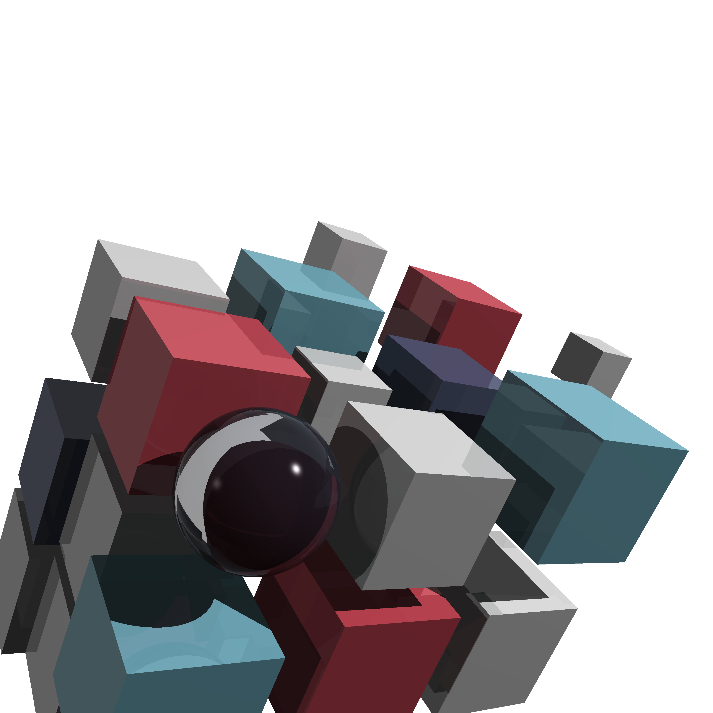
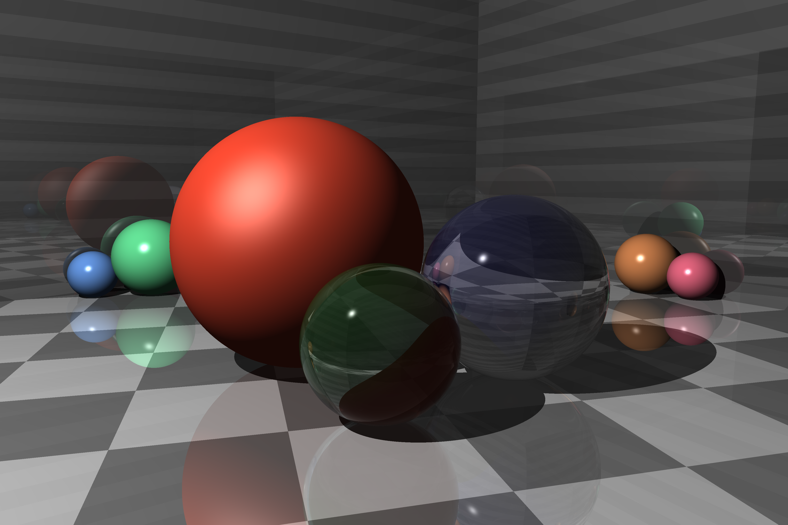
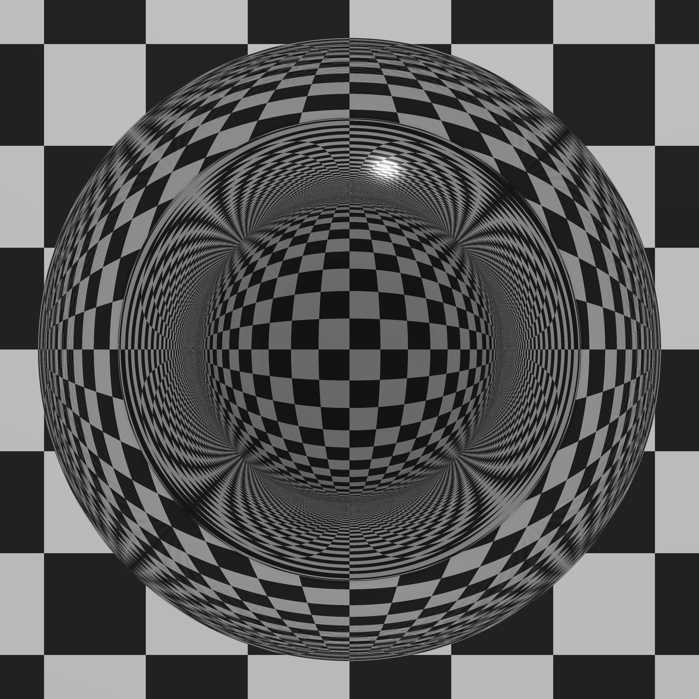
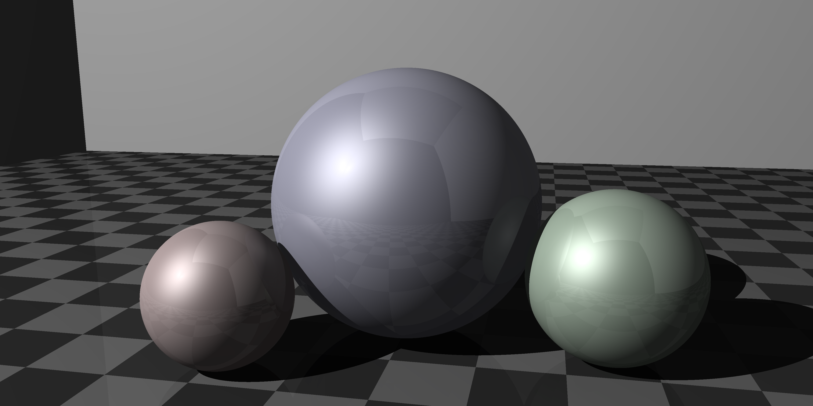
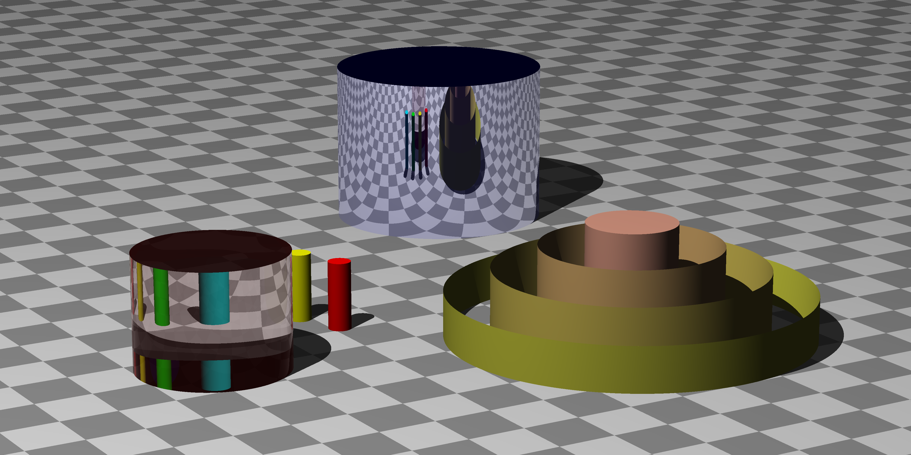
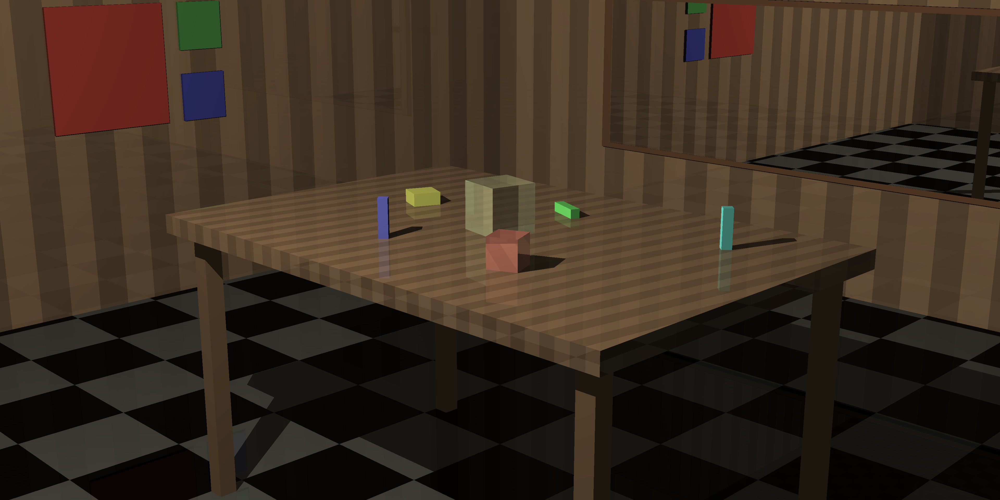
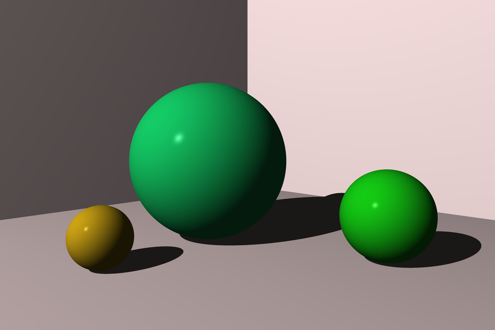
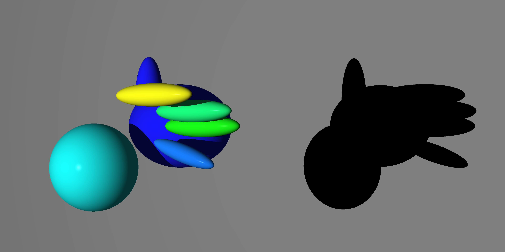

# k-tracer

[](https://github.com/przemo199/k-tracer/actions/workflows/ci.yaml)

Implementation of ray tracer from Ray Tracer Challenge book by [Jamis Buck](mailto:jamis@jamisbuck.org) using Kotlin programming language.

## Features

- Handling for multiple light sources
- Groups, Constructive Solid Geometry and Bounding Boxes implemented

## Building

The project is built with [Kotlin Toolchain](https://github.com/JetBrains/kotlin-toolchain) (configured in `project.yaml` and `module.yaml` files).
The `kotlin` / `kotlin.bat` wrapper scripts download everything needed on first use, including the JDK.

```
./kotlin test                                             # run tests
./kotlin run -m k-tracer -- scenes/cover.yaml cover.png   # render a scene
./kotlin package                                          # build an executable JAR
scripts\bench.cmd                                         # run JMH benchmarks (Windows, pinned to two cores)
```

Benchmarks live in `benchmarks/`; `scripts\bench.cmd --save-baseline before` followed by
`scripts\bench.cmd --baseline before` compares performance before and after a change.

On Windows use `kotlin.bat` instead of `./kotlin`. IntelliJ IDEA needs the
[Kotlin Toolchain plugin](https://plugins.jetbrains.com/plugin/31850-kotlin-toolchain).

## Usage

```
Usage: ktracer [<options>] <scenepath> <imageoutputpath>

  Render scene to image

Options:
  -r, --rendering-mode=(SERIAL|PARALLEL)
  -h, --help                              Show this message and exit
```

## Examples
















